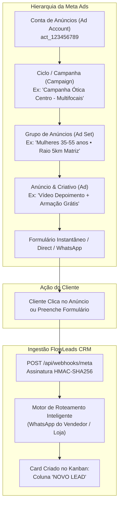

# Protocolo Executivo de Integração: Meta Ads & Instagram ➔ FlowLeads CRM

**Operação:** Grupo Mário Neto — Gestão de Leads Óticos & Meta Ads  
**Documento Técnico:** DOC-FL-META-INT-2026  
**Classificação:** Operacional Estratégico & Engenharia de Dados  
**URL de Produção:** [https://flowleads-crm-blush.vercel.app](https://flowleads-crm-blush.vercel.app)  
**Endpoint de Ingestão:** `https://flowleads-crm-blush.vercel.app/api/webhooks/meta`  

---

## 1. Visão Geral da Arquitetura & Mapeamento da Hierarquia Meta Ads

O objetivo desta integração é capturar, em tempo real (latência < 1 segundo), qualquer lead originado nas campanhas patrocinadas da Meta (Instagram Feed, Instagram Stories, Reels, Facebook Feed), extraindo todos os dados do cliente e a inteligência de tráfego, criando instantaneamente um card estruturado na coluna **NOVO LEAD** no Kanban do FlowLeads.

### Mapeamento da Estrutura de Tráfego da Meta para o FlowLeads



---

## 2. Matriz de Dados Extraídos da Meta Ads

Quando o lead interage com o anúncio, o FlowLeads extrai duas categorias de informações fundamentais:

### A. Dados Pessoais e Qualificação do Cliente

| Campo Extraído | Origem na Meta | Destino no Card do FlowLeads | Formato / Tratamento |
| :--- | :--- | :--- | :--- |
| **Nome Completo** | `full_name` ou `first_name` + `last_name` | **Título do Card** e Campo Nome | Caixa Alta (`UPPERCASE`) |
| **Telefone / WhatsApp** | `phone_number` | **Telefone do Lead** | Máscara brasileira `(XX) XXXXX-XXXX` + Botão com link direto para WhatsApp |
| **E-mail** | `email` | **E-mail Comercial** | Padronizado em minúsculas |
| **Uso de Óculos** | Pergunta customizada no Form | **Qualificação BANT / Histórico** | Ex: "Usa há mais de 3 anos", "Primeira vez" |
| **Loja de Preferência** | Pergunta customizada no Form | **Loja Negociada** | Vinculada às lojas cadastradas (Centro, Shopping, etc.) |
| **Tipo de Lente de Interesse** | Pergunta customizada no Form | **Observações do Lead** | Ex: "Multifocal Digital", "Visão Simples", "Lente de Contato" |

### B. Inteligência Estrutural da Meta Ads (Rastreabilidade de Tráfego)

| Metadado da Meta | Identificador da Graph API | Onde aparece no FlowLeads | Finalidade Estratégica |
| :--- | :--- | :--- | :--- |
| **Ciclo / Campanha** | `campaign_id` / `campaign_name` | **Campo Campanha** + Tag colorida no card | Identificar qual investimento gerou a oportunidade |
| **Grupo de Anúncios** | `adset_id` / `adset_name` | **Comentários de Origem** + Atributo do card | Saber qual público/segmentação tem melhor taxa de conversão |
| **Anúncio / Criativo** | `ad_id` / `ad_name` | **Comentários de Origem** + Atributo do card | Avaliar qual criativo/vídeo/copy atrai mais clientes |
| **Plataforma de Exibição** | `platform` (`fb` ou `ig`) | **Canal de Origem** | Saber se o cliente veio do Instagram ou Facebook |
| **Identificador Único** | `leadgen_id` | **Log de Auditoria Criptográfica** | Chave imutável para conciliação financeira e pós-venda |
| **Data e Hora do Clique** | `created_time` | **Data de Entrada na Fase** | Cálculo exato de tempo de resposta (*time-to-contact*) |

---

## 3. Apresentação Visual no Card "NOVO LEAD"

Assim que o evento é recebido, o card surge automaticamente na primeira coluna do Kanban:

1. **Título do Card:** Exibido em letras maiúsculas: `LEAD META: [NOME DO CLIENTE]`.
2. **Botão de WhatsApp Direto:** Ícone verde com link `https://wa.me/55...` permitindo que o consultor inicie a conversa no WhatsApp Web ou Mobile com 1 clique.
3. **Etiqueta da Campanha:** Tag visível no corpo do card (ex: `PROMOÇÃO MULTIFOCAL VARILUX`).
4. **Atribuição Automática:** O card já nasce com a foto/iniciais do vendedor responsável.
5. **Checklist Padrão do Supervisor Anexado:**
   - [ ] *Confirmar se possui receita médica atualizada (menos de 1 ano)*
   - [ ] *Identificar sintomas visuais (visão de perto, longe ou cansaço)*
   - [ ] *Sondar tipo de armação e material de lente desejado*
   - [ ] *Agendar dia e horário da visita à ótica*
   - [ ] *Confirmar agendamento 2 horas antes no WhatsApp*
6. **Aba de Comentários e Histórico (Auditoria de Tráfego):**
   ```text
   🎯 DADOS DE ORIGEM DO ANÚNCIO (META ADS):
   • Ciclo / Campanha: CAMPANHA ÓTICA CENTRO - MULTIFOCAIS
   • Grupo de Anúncios: MULHERES 35-55 ANOS • RAIO 5KM
   • Anúncio / Criativo: VIDEO_DEPOIMENTO_ARMACAO_GRATIS_V2
   • Plataforma de Exibição: INSTAGRAM (STORIES)
   • Formulário: CADASTRO_CONSULTA_EXPRESS
   • Lead ID Meta: 894729104829104
   ```

---

## 4. Estratégias de Anúncio Suportadas

O FlowLeads suporta as duas principais modalidades de anúncios de conversão da Meta:

### Modalidade A: Formulários Instantâneos Nativos (Meta Lead Ads) — *Recomendada*
- **Experiência do Usuário:** O cliente clica no anúncio no Instagram/Facebook. O formulário abre instantaneamente dentro do próprio app, já preenchido com o Nome, Telefone e E-mail da conta dele. O cliente clica em "Enviar" em menos de 5 segundos.
- **Fluxo Técnico:** A Meta dispara o webhook via POST para o endpoint do FlowLeads. O card é criado imediatamente no Kanban.

### Modalidade B: Anúncios de Clique para o WhatsApp (Click-to-WhatsApp)
- **Experiência do Usuário:** O cliente clica no anúncio e é direcionado diretamente para o aplicativo do WhatsApp comercial do vendedor ou da loja.
- **Rastreabilidade de Tráfego:** Para capturar o Ciclo, Grupo e Anúncio nesta modalidade:
  1. No Gerenciador de Anúncios da Meta, na seção de **Destino do WhatsApp**, configure a **Mensagem Pré-definida (Prefilled Text)** incluindo o código da campanha:
     > *"Olá, vi o anúncio no Instagram [REF: MULTIFOCAL-G01-AD03] e gostaria de saber mais sobre as armações e lentes!"*
  2. Ao receber a mensagem, o FlowLeads (ou o consultor via integração de WhatsApp) extrai a tag `REF:` e associa o lead à campanha exata no CRM.

---

## 5. Passo a Passo de Configuração no Meta for Developers & Meta Business

### Passo 5.1 — Criar ou Configurar o Aplicativo na Meta
1. Acesse o portal: [developers.facebook.com](https://developers.facebook.com).
2. Faça login com a conta administradora da Business Manager da ótica.
3. Clique em **Meus Aplicativos (My Apps)** ➔ **Criar Aplicativo**.
4. Selecione o tipo de aplicativo: **Empresa (Business)**.
5. Defina o nome: `FlowLeads CRM Integration` e vincule à Conta Empresarial da ótica.

### Passo 5.2 — Configurar o Webhook no Meta for Developers
1. No menu lateral do aplicativo, vá em **Adicionar Produtos** e ative **Webhooks**.
2. Na lista suspensa de objetos, selecione **Page (Página)** e clique em **Inscrever-se neste objeto**.
3. Preencha os campos exatamente com os valores:
   - **URL de Retorno (Callback URL):**  
     `https://flowleads-crm-blush.vercel.app/api/webhooks/meta`
   - **Token de Verificação (Verify Token):**  
     `flowleads_verify_token`
4. Clique em **Verificar e Salvar**. O FlowLeads responderá com status `200 OK` e o handshake será validado.
5. Na lista de eventos da Página, localize o evento **`leadgen`** e clique em **Inscrever-se (Subscribe)**.

### Passo 5.3 — Configurar o Segredo do App para Validação Criptográfica HMAC
1. No menu lateral do Meta for Developers, vá em **Configurações do Aplicativo ➔ Básico**.
2. Localize a **Chave Secreta do Aplicativo (App Secret)** e clique em "Mostrar".
3. Configure este valor na variável de ambiente `META_APP_SECRET` no painel da Vercel.
4. O FlowLeads utilizará esta chave para validar a assinatura digital de cada requisição via `crypto.timingSafeEqual`, impedindo qualquer injeção maliciosa de dados.

### Passo 5.4 — Permissões de Acesso e Token Permanente de Sistema
No **Meta Business Suite** (Configurações do Negócio ➔ Usuários ➔ Usuários do Sistema):
1. Crie um **Usuário de Sistema** (ex: `FlowLeads-System-User`) com função de Administrador.
2. Adicione os ativos da Página do Facebook e da Conta de Anúncios a esse usuário com controle total.
3. Clique em **Gerar Novo Token** e selecione as seguintes permissões obrigatórias:
   - `leads_retrieval` (Permite buscar os dados completos do lead via Graph API)
   - `pages_manage_ads` (Permite ler formulários vinculados aos anúncios)
   - `pages_read_engagement` (Permite ler interações na página)
   - `pages_show_list` (Permite listar as páginas administradas)
4. Defina a validade do Token como **Nunca expirar (Never)**.
5. Salve este token na variável `META_ACCESS_TOKEN` na Vercel.

### Passo 5.5 — Subscrever a Página aos Eventos do Aplicativo
Para que a Página envie os leads para o Webhook:
- No Graph API Explorer ou via chamada HTTP direta, execute:
  ```http
  POST https://graph.facebook.com/v21.0/{PAGE_ID}/subscribed_apps
  Authorization: Bearer {PAGE_ACCESS_TOKEN}
  Content-Type: application/json

  {
    "subscribed_fields": ["leadgen"]
  }
  ```
- Resposta esperada: `{"success": true}`.

---

## 6. Procedimento de Teste com a Meta Lead Ads Testing Tool

A Meta disponibiliza uma ferramenta oficial de testes em tempo real que não consome orçamento de anúncios:

1. Acesse: [facebook.com/tools/lead-ads-testing](https://developers.facebook.com/tools/lead-ads-testing)
2. Selecione a **Página do Facebook** da ótica e o **Formulário Instantâneo** da campanha ativa.
3. Se desejar personalizar os dados de teste, clique em **Preview Form (Visualizar Formulário)** e preencha:
   - Nome: `CLIENTE TESTE META ADS`
   - Telefone: `(11) 98888-7777`
   - E-mail: `leadteste@otica.com.br`
4. Clique em **Criar Cadastro (Create Lead)**.
5. Abra o FlowLeads no navegador:
   - O card surge **instantaneamente** na coluna **NOVO LEAD**.
   - O telefone aparece com link do WhatsApp.
   - O comentário interno traz todos os dados estruturados da campanha.

---

## 7. Roteamento Inteligente por WhatsApp (Vendedores & Lojas)

O FlowLeads possui um algoritmo de roteamento que conecta o anúncio ao vendedor certo:

1. **Cadastro de Vendedores:** No menu **Usuários** (acesso Supervisor), cada consultor tem seu WhatsApp comercial salvo (ex: `11999998888`).
2. **Campanhas Segmentadas por Loja:** Quando o anúncio da Loja Shopping Sul é acionado, o anúncio direciona para o número daquela unidade.
3. **Distribuição Automática:** O motor do FlowLeads lê o campo `destination_whatsapp` do evento da Meta e atribui o lead diretamente ao consultor responsável por aquele número.
4. **Fallback:** Caso o número não seja identificado, o lead é alocado para a Supervisão Geral / Recepção para triagem imediata.

---

## 8. Governança e Regras Comerciais Óticas Imutáveis

Para assegurar a disciplina da equipe de vendas:
- **3 Fases Imutáveis:** As colunas `NOVO LEAD`, `FECHADO` e `PERDIDO` são travadas contra renomeação ou exclusão acidental.
- **Trava de Agendamento Obrigatório:** O consultor **não consegue** arrastar o lead de `NOVO LEAD` para as etapas seguintes sem preencher previamente a **Loja Negociada** e a **Data/Hora Estimada da Visita**.
- **Trava de Dados Financeiros:** Número da Ordem de Serviço (OS), Valor Final e Vendedor que Fechou só são liberados quando o card atinge o status `FECHADO`.
- **Persistência Permanente:** Todos os dados são gravados no Supabase PostgreSQL com direct-write e política de zero cache efêmero. Nenhuma informação é perdida ao pressionar `F5` ou `Ctrl + F5`.
