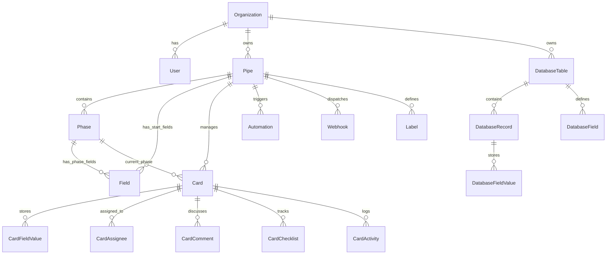

# Modelo de Dados e API Reversa do Pipefy (CRM & BPM)

## 1. Diagrama Entidade-Relacionamento (Mermaid)

## 2. Entidades Principais e Atributos

### Organization
- `id` (String / UUID)
- `name` (String)
- `slug` (String, unique)
- `createdAt`, `updatedAt`

### User / Membership
- `id`, `name`, `email`, `passwordHash`, `role` (ADMIN, MEMBER, VIEWER)
- `organizationId`

### Pipe
- `id`, `organizationId`
- `name`, `description`, `icon`, `color`
- `isPublicFormEnabled` (Boolean), `publicFormSlug` (String, unique)
- `slaEnabled` (Boolean)

### Phase
- `id`, `pipeId`, `name`, `description`, `order` (Int)
- `color` (String)
- `isFinalWon` (Boolean), `isFinalLost` (Boolean)
- `slaHours` (Int, opcional)
- `wipLimit` (Int, opcional)

### Field (Start Form e Phase Fields)
- `id`, `pipeId`, `phaseId` (null se for do Start Form)
- `label`, `identifier` (slug), `type` (TEXT, NUMBER, CURRENCY, EMAIL, PHONE, DATE, SELECT, MULTI_SELECT, CHECKBOX, URL)
- `isRequired` (Boolean)
- `options` (JSON string array para selects)
- `order` (Int)

### Card (Lead / Oportunidade)
- `id`, `pipeId`, `currentPhaseId`
- `title` (String - ex: Nome do Lead / Empresa)
- `dueDate` (DateTime, opcional)
- `priority` (LOW, MEDIUM, HIGH, URGENT)
- `dealValue` (Float, opcional)
- `slaStatus` (ON_TRACK, WARNING, OVERDUE)
- `phaseEnteredAt` (DateTime)
- `createdAt`, `updatedAt`

### CardFieldValue
- `id`, `cardId`, `fieldId`, `value` (Text / JSON)

### Automation
- `id`, `pipeId`, `name`, `isActive` (Boolean)
- `triggerType` (CARD_CREATED, CARD_MOVED, FIELD_UPDATED)
- `triggerConfig` (JSON: phaseId, fieldId, value)
- `conditions` (JSON: regras lógicas)
- `actionType` (UPDATE_FIELD, MOVE_CARD, ASSIGN_USER, SEND_EMAIL, TRIGGER_WEBHOOK)
- `actionConfig` (JSON)

### Webhook
- `id`, `pipeId`, `name`, `url`, `events` (JSON array: card.created, card.moved, etc.), `isActive`

### DatabaseTable & DatabaseRecord
- Permite armazenar entidades conectadas (ex.: Clientes, Empresas, Produtos) com relacionamento 1:N com Cards.
